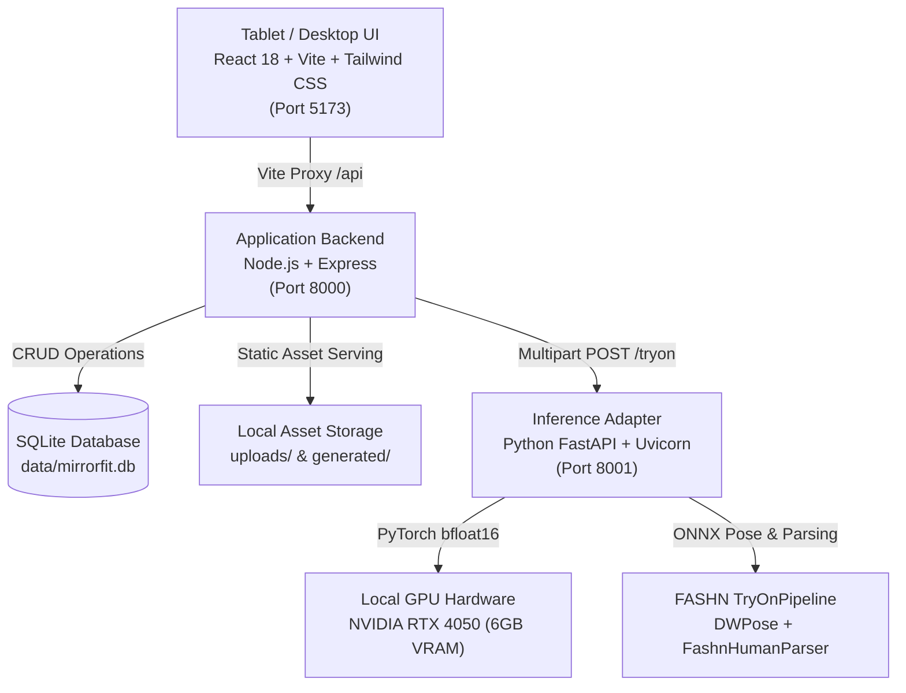

# Armscye — Smart Virtual Fitting Room for Indian Retail

<div align="center">


<p align="center">
  <strong>Authentic virtual try-on for Indian ethnic & western retail apparel, powered by the open-source FASHN VTON v1.5 diffusion pipeline running locally on NVIDIA RTX GPU.</strong>
</p>

[Quick Start](#-quick-start) • [Architecture](#-architecture) • [Demo Walkthrough](#-demo-walkthrough) • [API Reference](#-api-reference) • [Documentation](docs/)

</div>

---

## 1. Product Summary

**Armscye** (working title *MirrorFit AI*) is a tablet-friendly virtual fitting application engineered for Indian apparel retail stores. A customer selects an ethnic or contemporary garment from the retailer's physical catalogue, uploads or captures a front-facing photo, and previews the garment realistically rendered on their own body using pixel-space diffusion inference.

### Core Value Proposition
- **Genuine FASHN VTON v1.5 Diffusion:** Authentically drapes real garments over real customer postures in pixel space. Zero hallucinated fake clothing or synthetic character swaps.
- **Optimized for Indian Apparel:** Pre-seeded catalogue with Indian Kurtas, Nehru Jackets, Linen Shirts, Chinos, and Anarkali Gowns.
- **Single-Upload Multi-Garment Fitting:** Upload or snap a customer photo once per session. Try on dozens of kurtas, shirts, and trousers without re-taking photos.
- **Deterministic Catalogue Recommendations:** Suggests alternatives matching palette harmony, style tags, and budget strictly from available in-store inventory.
- **Privacy First:** Temporary session storage automatically wipes customer photos and generated outputs on session completion.

---

## 2. Architecture & Design



For full architectural diagrams and deep-dive design rationales, consult [`docs/ARCHITECTURE.md`](docs/ARCHITECTURE.md).

---

## 3. Hardware Requirements & Benchmarks

The inference adapter is pre-warmed and verified on local hardware:
- **GPU:** NVIDIA GeForce RTX 4050 Laptop GPU (6 GB VRAM, Ada Lovelace)
- **Precision:** Native `bfloat16` (`torch.bfloat16`)
- **VRAM Footprint:** ~3.2 GB idle; ~4.8 GB peak during diffusion sampling
- **Inference Speed:** ~34 to 38 seconds for 20 diffusion timesteps

---

## 4. Quick Start

### Prerequisites
- Linux / WSL2 with NVIDIA Drivers (Driver 550+ / CUDA 12+)
- Python 3.10+
- Node.js 18+

### Setup & Launch in 3 Steps

#### 1. Clone the Repository
```bash
git clone https://github.com/kaizen-abhinav/Armscye.git
cd Armscye
```

#### 2. Install Dependencies & Download Model Weights
```bash
# Set up Python virtual environment
python3 -m venv .venv
source .venv/bin/activate
pip install torch torchvision --index-url https://download.pytorch.org/whl/cu124
pip install -e ./fashn-vton-1.5 fastapi uvicorn python-multipart pydantic

# Download FASHN VTON v1.5 weights (~2 GB)
python fashn-vton-1.5/scripts/download_weights.py --weights-dir fashn-vton-1.5/weights

# Install backend and frontend npm packages
cd backend && npm install && cd ..
cd frontend && npm install && cd ..

# Generate sample catalogue product assets
python backend/seed_images.py
```

#### 3. Run the Entire Stack
```bash
./start.sh
```
The script will boot the Python VTON Service (:8001), Express Backend (:8000), and Vite UI (:5173).  
Open **http://localhost:5173** in your browser.

---

## 5. Demo Walkthrough

Follow the step-by-step judge script in [`docs/DEMO_SCRIPT.md`](docs/DEMO_SCRIPT.md):

1. **Header Telemetry:** Note the live hardware status pill: `NVIDIA RTX 4050 (bf16)`.
2. **Customer Photo (Step 1):** Click **"⚡ 1-Click Demo Model"** (or use the webcam) and tap **"Continue"**.
3. **Select Garment (Step 2):** Select the **"Emerald Heritage Silk Kurta"** (or any outfit) and tap **"Try On This Outfit"**.
4. **Try-On Processing (Step 3):** Watch the dual-stage DWPose keypoint detection and diffusion stages.
5. **Inspect Result (Step 4):** Toggle the **"Side-by-Side"** view to compare customer posture and garment drape.
6. **Switch Garments (Step 5):** Tap **"Try Another Garment"** to try another outfit using the same session photo without re-uploading.
7. **Recommendations (Step 6):** Scroll down to view catalogue-grounded alternatives with attribute explanations (*"Matching Green shade"*, *"Within budget"*).
8. **Reset Session (Step 7):** Tap **"Clear Session"** to wipe temporary files from disk.

---

## 6. Project Directory Layout

```
Armscye/
├── backend/                  # Application Express server & database
│   ├── server.js             # API routes & static serving
│   ├── db.js                 # SQLite schema & catalogue seeding
│   ├── seed_images.py        # Studio garment imagery generation
│   └── package.json
├── frontend/                 # React 18 + Vite + TypeScript application
│   ├── src/
│   │   ├── components/       # UI screens (Photo, Garment, Result, etc.)
│   │   ├── types.ts          # TypeScript interfaces
│   │   ├── App.tsx           # Session state orchestration
│   │   └── main.tsx
│   ├── vite.config.ts        # Reverse proxy config (:5173 -> :8000)
│   └── tailwind.config.js    # Luxury retail styling system
├── services/
│   └── vton-service/         # Dedicated Python FastAPI inference adapter
│       └── main.py           # Pre-warmed TryOnPipeline & CUDA management
├── fashn-vton-1.5/           # FASHN VTON v1.5 open-source package
│   ├── src/fashn_vton/       # TryOn MMDiT, DWPose, preprocessing
│   └── scripts/              # Weight downloaders & debug utilities
├── docs/                     # Extended documentation
│   ├── ARCHITECTURE.md       # Microservice design & sequence diagrams
│   ├── API.md                # Comprehensive REST API specifications
│   └── DEMO_SCRIPT.md        # Pitch script & judge Q&A guide
├── uploads/                  # Store catalogue & customer session assets
├── .env.example              # Environment variables template
├── start.sh                  # One-command startup bash script
└── README.md
```

---

## 7. API Reference

See [`docs/API.md`](docs/API.md) for full request/response schemas.

- `GET /api/health` — GPU VRAM & service telemetry.
- `GET /api/products` — Catalogue search & filters.
- `POST /api/products` — Store owner garment upload.
- `POST /api/try-ons` — Execute virtual try-on with customer photo reuse.
- `DELETE /api/session` — Purge temporary session images.
- `GET /api/products/:id/similar` — Deterministic recommendations.

---

## 8. License & Attribution

- **Armscye Codebase:** Released under the [Apache-2.0 License](LICENSE).
- **FASHN VTON v1.5:** Apache-2.0 License. [GitHub](https://github.com/fashn-AI/fashn-vton-1.5) | [HuggingFace](https://huggingface.co/fashn-ai/fashn-vton-1.5)
- **DWPose:** Apache-2.0 License (IDEA-Research).
- **YOLOX:** Apache-2.0 License (Megvii-BaseDetection).
- **FashnHumanParser:** Separately licensed third-party dependency ([FASHN AI](https://github.com/fashn-AI/fashn-human-parser)).
