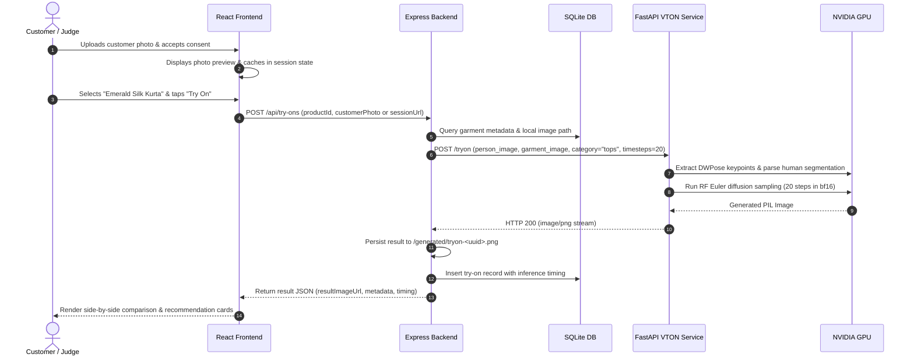

# Armscye / MirrorFit AI — Architectural Specification

## 1. Executive Summary

**Armscye** (working title *MirrorFit AI*) is a distributed, service-oriented virtual try-on application engineered specifically for Indian retail apparel stores. Built for tablet-driven in-store kiosks and client web sessions, it couples a high-responsiveness frontend with a decoupled microservice inference engine hosting **FASHN VTON v1.5** on dedicated GPU hardware.

---

## 2. System Architecture Diagram

```mermaid
graph TB
    subgraph ClientLayer ["Client Layer"]
        UI["Tablet / Web Application (React 18 + Vite + Tailwind CSS)"]
    end

    subgraph ApplicationLayer ["Application & Orchestration Layer (Node.js :8000)"]
        Server["Express API Server"]
        Multer["Multer Storage Handler"]
        SQLite[(SQLite DB: mirrorfit.db)]
        StaticFiles["Static File Servicing (/uploads, /generated)"]
    end

    subgraph InferenceLayer ["Inference Adapter Layer (Python FastAPI :8001)"]
        FastAPI["FastAPI Inference Server"]
        Pipeline["FASHN TryOnPipeline (Pre-warmed in VRAM)"]
        DWPose["DWPose ONNX Detector (Pose Estimation)"]
        Parser["FashnHumanParser (Body Segmentation)"]
        TorchMMDiT["TryOn MMDiT Diffusion Model (bfloat16)"]
    end

    subgraph Hardware ["Hardware Layer"]
        GPU["NVIDIA GPU (e.g. GeForce RTX 4050 6GB / H100)"]
    end

    UI -->|HTTP / JSON & Multipart| Server
    Server -->|Read/Write Operations| SQLite
    Server -->|Disk Storage| StaticFiles
    Server -->|Multipart Proxy (POST /tryon)| FastAPI
    FastAPI --> Pipeline
    Pipeline --> DWPose
    Pipeline --> Parser
    Pipeline --> TorchMMDiT
    TorchMMDiT -->|CUDA Accelerations| GPU
```

---

## 3. Core Architectural Decisions

### 3.1 Service Decoupling (Inference Adapter Pattern)
The AI virtual try-on model is kept completely isolated inside `services/vton-service/main.py`. The Node.js Express server manages business logic, SQLite catalogue records, and customer session lifecycles, and communicates with the Python service over standard HTTP multipart POST calls.
- **Portability:** If local laptop GPU resources are constrained, the Python service can be relocated to an external cloud GPU instance (RunPod, Lambda, AWS EC2) by modifying a single environment variable: `VTON_SERVICE_URL`.
- **Zero Frontend Rewrite:** The React frontend remains completely agnostic of the inference runtime and hardware location.

### 3.2 Pre-warmed Model Pipeline with Lifespan Management
Loading diffusion weights and ONNX models on every request introduces 10–15 seconds of unacceptable disk I/O latency.
- The FastAPI service employs an `asynccontextmanager` lifespan handler that instantiates `TryOnPipeline` **once at service startup**.
- Model parameters remain resident in GPU VRAM, allowing subsequent try-on requests to initiate diffusion sampling instantly.

### 3.3 GPU Memory Optimization (`bfloat16` & Cache Purging)
Consumer and mobile GPUs (such as the NVIDIA RTX 4050 Laptop GPU with 6 GB VRAM) require disciplined memory budgeting:
- Model weights run in native `bfloat16` precision (`torch.bfloat16`), halving VRAM requirements compared to float32 with zero quality degradation.
- After every inference pass, the service executes `torch.cuda.empty_cache()` to reclaim PyTorch caching allocator blocks and avoid memory fragmentation.

---

## 4. End-to-End Request Lifecycle



---

## 5. Storage Abstraction & Privacy Controls

1. **Product Images (`uploads/products/`):** Permanent catalogue assets, served statically.
2. **Customer Photos (`uploads/customers/`):** Ephemeral assets identified by randomized UUIDs.
3. **Generated Outputs (`generated/`):** Temporary diffusion results.
4. **Session Cleanup (`DELETE /api/session`):** Completely deletes customer uploads and generated result files from the disk, preventing data leakage or persistent biometric storage.
